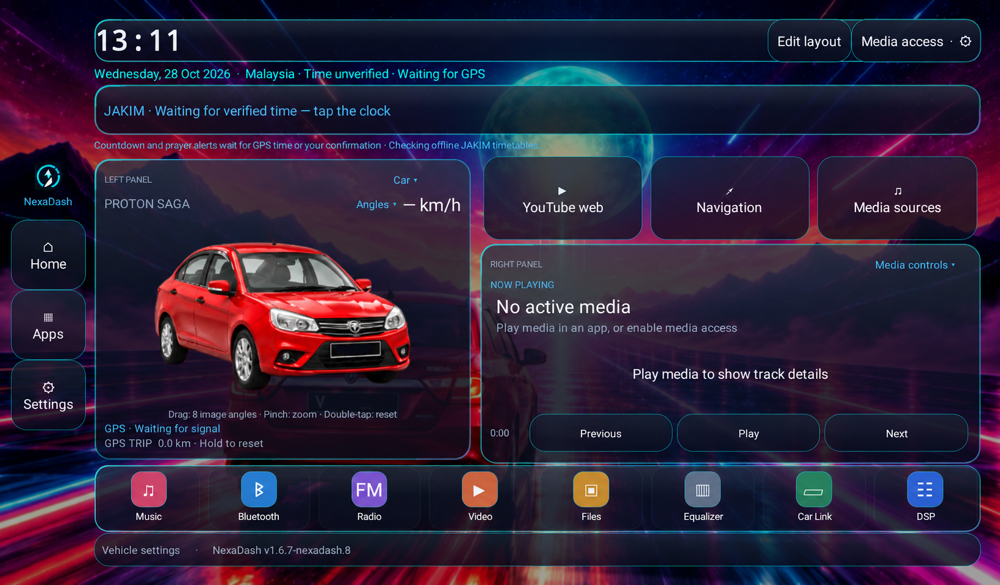

# Preview kereta sendiri dalam NexaDash



*Contoh reka bentuk versi terdahulu, plat disunting untuk privasi. Untuk pemasangan launcher, mula dengan [panduan head unit](PUBLIC_BETA_MS.md).*

Preview Saga merah yang disertakan menggunakan **8 imej sudut**, bukan model 3D. Pengguna boleh drag untuk tukar sudut, pinch untuk zoom dan double-tap untuk reset. Imej tidak bergerak ketika idle. Untuk preview kereta sendiri, pilih cara yang sesuai:

| Mahu buat apa? | Cara yang ada sekarang | Perlu bina APK? |
| --- | --- | --- |
| Guna Saga yang disertakan | Pilih Car preview → Angles ▾ → Car image angles (lightweight) | Tidak |
| Paparkan video kereta sendiri | Import MP4 melalui Choose car video… | Tidak |
| Tukar kepada kereta sendiri dan drag antara 8 sudut | Sediakan 8 PNG, susun menjadi atlas, gantikan aset dalam source | **Ya** |
| Import foto/8 PNG terus dari Settings | Belum ada menu import gambar dalam Next1.1 | Belum tersedia |

Preview kereta tidak memerlukan companion Maps atau app tambahan. Panduan ini menggunakan label menu yang wujud dalam source semasa; layout skrin mungkin berbeza mengikut versi.

## 1. Cara paling mudah: video sendiri, tanpa coding

1. Sediakan video kereta dalam **MP4 / H.264**. Cadangan ringan: landscape720p, 24/30fps dan sekitar5–10 saat. Boleh rakam kereta dari beberapa sudut atau gunakan video render yang disediakan sendiri.
2. Salin ke folder **Download** atau USB yang boleh dibuka oleh pemilih fail Android.
3. Buka NexaDash → pilihan **left panel → Car preview**.
4. Ketuk **Angles ▾ / Cutout ▾ / Video ▾** di atas kereta → **Choose car video…**.
5. Pilih MP4 dan tunggu mesej **Car video ready**. Ketuk preview untuk Play/Pause.
6. Selepas import, **Imported video preview** muncul dalam pilihan Vehicle view. Pilih **Car image angles (lightweight)** untuk kembali ke imej asal.

Had import dalam kod: **32MiB**, durasi maksimum **2 minit**, jumlah piksel setiap frame maksimum **3840×2160**. Ini had penerimaan, bukan jaminan semua codec/firmware boleh memainkan fail. App menyimpan salinan video dalam storan peribadinya; import yang gagal mengekalkan fail sebelumnya. Preview dimatikan bunyi, tidak auto-play dan tidak auto-loop. Apabila satu panel video/web/native dipilih, preview kereta kembali kepada imej untuk mengelakkan dua player serentak.

**Video biasa kekal berlatar.** Import tidak membuang background secara automatik. MP4 preview juga tidak boleh di-drag untuk berpusing bebas; gerakannya mengikut rakaman. Jangan import PNG atau fail atlas melalui pemilih video.

## 2. Cara seperti preview Saga: sediakan 8 sudut kereta

Cara ini untuk pengguna yang mahu bina APK sendiri. Ambil gambar kereta sendiri, render model yang dibenarkan, atau gunakan alat penjana imej pilihan sendiri. Gunakan model, warna, rim, body kit dan plat yang konsisten. Kamera pada ketinggian yang hampir sama; pastikan tayar, bumper dan bumbung tidak terpotong. Bagi perkongsian awam, boleh gunakan plat rekaan seperti **NEXA**.

Sediakan **lapan fail PNG berasingan dengan background transparent**. Bahagian transparent sebenar diperlukan; corak petak-petak yang dicetak dalam imej bukan alpha transparency. Had alat susun:16 megapiksel setiap PNG; cadangan sekitar1024×768 atau1024×1024 sudah memadai. Simpan dalam folder `my-car` dengan nama berikut:

| Fail | Sudut, dilihat pada imej |
| --- | --- |
| `01.png` | Depan tepat |
| `02.png` | Depan tiga suku, muncung menghadap kiri |
| `03.png` | Sisi, muncung menghadap kiri |
| `04.png` | Belakang tiga suku, muncung menghadap kiri |
| `05.png` | Belakang tepat |
| `06.png` | Belakang tiga suku, muncung menghadap kanan |
| `07.png` | Sisi, muncung menghadap kanan |
| `08.png` | Depan tiga suku, muncung menghadap kanan — sudut awal/reset |

Contoh susunan asal: baca baris atas dari kiri ke kanan, kemudian baris bawah. Ia **bukan** grid dengan petak yang semuanya sama besar.

[Contoh atlas dengan plat kosong](../res/drawable-nodpi/saga_angles.png)

### Contoh prompt untuk sediakan gambar

Lampirkan gambar rujukan kereta sendiri dan minta **satu sudut setiap kali**. Ubah teks dalam kurungan untuk setiap fail:

```text
Gunakan foto rujukan ini untuk menghasilkan SATU imej kereta penuh.
Model/tahun: [model dan tahun]. Warna: [warna].
Kekalkan bentuk badan, rim, body kit, lampu dan plat [NEXA] yang sama.
Sudut: [depan tiga suku, muncung menghadap kanan].
Kamera pada ketinggian lampu, perspektif realistik, kereta di tengah.
Seluruh kereta termasuk tayar dan bumper mesti berada dalam frame.
Tiada orang, jalan, pemandangan, bayang lantai besar, teks atau watermark.
Background transparent, output PNG dengan alpha jika disokong.
Jangan hasilkan kolaj atau beberapa kereta dalam satu imej.
```

Alat penjana mungkin mengubah detail atau menghasilkan latar walaupun diminta transparent. Semak hasilnya dan buang background dalam editor jika perlu. NexaDash tidak menghasilkan sudut baharu daripada satu foto secara automatik; AI/rendering dibuat di luar app. Gambar sudut yang tidak konsisten akan nampak melompat semasa drag.

## 3. Susun 8 PNG menjadi atlas

Download [source branch NexaDash semasa](https://github.com/shazwannoor95-jpg/klikdash/tree/main) atau [ZIP source](https://codeload.github.com/shazwannoor95-jpg/klikdash/zip/refs/heads/main), kemudian extract ke folder baharu. Dari folder root yang mengandungi `settings.gradle` dan `tools`, gunakan Python3.10+ dengan Pillow:

Windows PowerShell:

```powershell
py -m pip install "Pillow>=10"
py tools/build_car_atlas.py --input my-car --output build/car-preview/saga_angles.png
```

Linux/macOS, gunakan environment Python sendiri:

```sh
python3 -m venv .venv
. .venv/bin/activate
python -m pip install "Pillow>=10"
python tools/build_car_atlas.py --input my-car --output build/car-preview/saga_angles.png
```

[Alat build_car_atlas.py](../tools/build_car_atlas.py) memotong ruang alpha kosong, mengekalkan aspect ratio dan menyusun imej ke koordinat tepat yang dibaca oleh `SagaAngleView`. Ia menghasilkan PNG RGBA **1774×887**. Ia tidak menjana sudut, membuang latar atau menyunting foto sumber. Fail sedia ada tidak ditimpa melainkan `--force` diberikan. Semua input disemak sebelum output disimpan.

1. Buka `build/car-preview/saga_angles.png` dan semak semua sudut. Pastikan tiada background, imej terpotong atau susunan terbalik.
2. Backup aset dalam checkout sendiri, kemudian copy hasil tadi ke **`res/drawable-nodpi/saga_angles.png`**, menggantikan aset Saga.
3. Kekalkan nama fail itu. Jangan letak PNG dalam `drawable` biasa atau hanya menamakan semula satu gambar menjadi atlas. Menukar saiz/koordinat atlas tanpa menukar renderer menyebabkan crop tersalah.
4. Imej dibaca secara sampled dan terhad kepada2MiB bitmap dalam app. Atlas bersaiz asal mematuhi had itu; tidak perlu menaikkan resolusi untuk skrin head unit.

Untuk menjalankan semula alat, gunakan output lain atau tambahkan `--force`. Input `01.png` hingga `08.png` kekal tidak berubah. Folder Python `.venv` dan input peribadi `my-car` diabaikan oleh Git projek ini. Output sementara berada dalam `build` yang juga diabaikan. Aset akhir yang disalin ke `res` akan termasuk dalam APK dan boleh dikongsi; semak dahulu imej/plat yang hendak diterbitkan.

## 4. Tukar nama kereta dan bina APK

Menukar gambar tidak menukar tulisan **PROTON SAGA** secara automatik. Dalam checkout sendiri:

- `src/com/shazwan/sagadash/DashboardActivity.java`: cari `text("PROTON SAGA",16,MUTED)` dalam `buildVehicleContent()` dan ubah teks model sahaja.
- Dalam fail sama, `vehicleDialog()` mengandungi label `Car image angles (lightweight)`. Boleh tukar label imej kepada model sendiri; jangan namakan semula label **Transparent Saga video** jika video asal belum diganti.
- `src/com/shazwan/sagadash/SagaAngleView.java`: dalam `describe()`, tukar ayat `Red Saga NEXA` untuk padankan kereta sendiri. Itu label accessibility, bukan lukisan plat. Plat pada preview datang daripada piksel PNG dan mesti diubah pada gambar jika mahu.

Buka root projek dalam Android Studio, tunggu Gradle Sync, pilih konfigurasi **app**, kemudian Run pada emulator landscape. Semak8 sudut, drag, pinch, double-tap/reset, saiz panel dan teks model. **Build Studio lalai menghasilkan NexaDash Native Lab**, bukan identiti APK Next GitHub; kelas/package Java tidak perlu dinamakan semula untuk menukar kereta. [Panduan Android Studio](WINDOWS_ANDROID_STUDIO_MS.md) menerangkan setup IDE, tetapi rujuk branch semasa di atas untuk versi eksperimen terkini.

Untuk identiti **Next** melalui shell build, ikut [tools/next/README.md](../tools/next/README.md). Untuk APK sendiri, gunakan signing key sendiri dan simpan backup di luar repo. APK custom tidak boleh menimpa APK GitHub dengan package sama jika signing key berbeza; jangan terus uninstall app yang mempunyai data penting. Menukar preview kereta tidak memerlukan patch Maps atau APK vendor.

## 5. Jika mahu video transparent sendiri

Video transparent bundled yang lama telah ditarik balik untuk privasi. Next1.2 tidak menawarkannya dalam menu; mod imej dan import video sendiri kekal. Fail raw dalaman kini placeholder neutral.

[Nota pipeline video](TRANSPARENT_VIDEO.md) ialah rujukan build-time lama untuk segmentation U2Net dan encoding FFmpeg, bukan video contoh untuk dimuat turun. Video biasa yang diimport tetap berlatar. Menggunakan packed RGB/matte sendiri memerlukan aset dan laluan/menu source yang diselaraskan semula; ia bukan ciri import transparent yang tersedia dalam APK semasa.

## Jika preview tidak menjadi

| Masalah | Semak |
| --- | --- |
| Choose car video tidak menerima PNG | Pemilih itu khusus video; PNG8 sudut memerlukan langkah atlas/build di atas |
| Latar putih/hitam masih ada | PNG/video masih berlatar; menukar extension tidak membuang latar |
| Kereta terpotong / sudut salah | Susunan01–08, saiz1774×887 dan koordinat atlas; jangan ubah `BOUNDS` tanpa menyelaraskan aset |
| Preview nampak berbeza antara sudut | Foto/render tidak konsisten; semak model, kamera dan perspektif sebelum pack |
| Masih keluar Saga selepas rebuild | Semak aset dalam root `res/drawable-nodpi`, app/configuration yang di-run dan versi yang dipasang |
| Video tidak boleh play | Cuba MP4 H.264720p kecil; semak had import dan codec firmware |
| Kereta menjadi imej bila Maps/video panel aktif | Satu inline player sahaja; ini tingkah laku semasa untuk mengehadkan penggunaan sumber |

[Kembali ke panduan public beta](PUBLIC_BETA_MS.md) · [Panduan video/shortcut sedia ada](VIDEO_AND_SHORTCUTS_MS.md)
