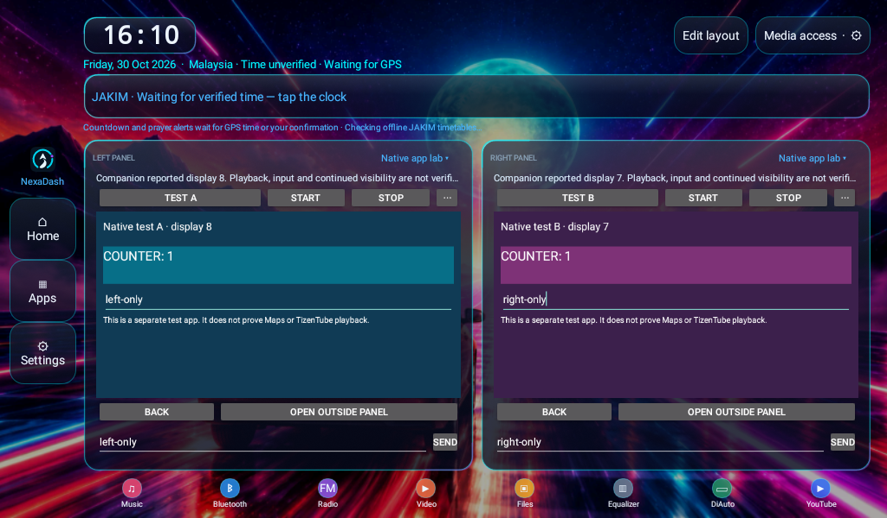

# Next1.4 — dua companion native dalam panel

Next1.4 membenarkan **dua app companion berbeza** berada dalam left/right panel serentak. Setiap panel mempunyai token proxy, display, binding, input worker dan rekod startup sendiri. Memilih native pada panel kedua tidak menutup panel pertama. **Ini belum menjadi host umum untuk semua app asal.**

## Download dan pasang pada head unit

1. [NexaDash Next1.4 (~3MB)](https://raw.githubusercontent.com/shazwannoor95-jpg/NexaDash/main/dist/next/NexaDash-Next-1.4.apk). Boleh update atas Next1.3 dengan signing key sama, tanpa uninstall. Host kini mengisytiharkan permission signature sendiri; untuk pemasangan baharu, pasang Next dahulu.
2. [Maps · NexaDash Next ARM32 (~63MB)](https://raw.githubusercontent.com/shazwannoor95-jpg/NexaDash/nexadash-maps-next-companion/Maps-NexaDash-Next-arm32.apk). Jika companion ini sudah dipasang, tidak perlu pasang semula; APK Maps tidak berubah dalam update ini.
3. [TizenTube · NexaDash Next ARM32 (~81MB)](https://raw.githubusercontent.com/shazwannoor95-jpg/NexaDash/nexadash-tizentube-next/TizenTube-NexaDash-Next-arm32.apk). **TizenTube Native Lab lama / app asal bukan companion Next ini.** Ia dipasang berasingan dan menggunakan signing key serta permission Next.

Dalam **NexaDash Next**, pilih:

- **Left panel → TizenTube · native Next companion (test) → Start**.
- **Right panel → Google Maps · native Next companion (test) → Start**.

Kiri/kanan boleh diterbalikkan. Pilih mod melalui selector panel, bukan ikon Apps atau butang external controls. Start diperlukan untuk setiap panel; tiada autoplay selepas load/resume. App yang sama tidak dibenarkan berebut dua panel—pilih dua companion berbeza.

Jika setup/permission perlu dilakukan di luar panel, gunakan tindakan **Open outside panel** secara sengaja, selesaikan setup, kembali dan Start kedua-duanya semula. Membuka app di luar panel tidak dikira sebagai kejayaan hosting native. Meninggalkan dashboard atau masuk Edit menghentikan sesi native; app background services tidak di-force-stop oleh host.

## Apa yang telah disahkan?

**47 assertions lulus pada emulator API27 x86_64,1024×600/density160**, menggunakan dua APK ujian native sebenar dengan UID berasingan. Piksel app disemak dalam kedua-dua panel, bukan sekadar menerima display ID. Sentuhan dihantar melalui input routing Android pada skrin utama; counter dan text field dalam app yang betul sahaja berubah.

Ujian turut menyemak resize satu panel, perlindungan duplicate package, kegagalan sebelah kanan tanpa menutup kiri, laporan startup berasingan, Stop/mode switch bebas dan cleanup selepas meninggalkan dashboard. Kembali ke dashboard tidak auto-start. [Rekod QA dan had ujian](qa/dual-native-api27.json) · [Sumber ujian](../tests/DualNativeChecks.java).

**Konfigurasi emulator:** imej AOSP API27 asal tidak mengiklankan `android.software.activities_on_secondary_displays`. Ciri itu ditambah pada sistem emulator ujian untuk meniru capability yang laporan TEST9278B sudah tunjukkan. Host dan kedua-dua app ujian berjalan sebagai UID app biasa; penambahan feature pada emulator tidak memberi NexaDash permission pengurusan stack/input sistem. Tiada perubahan/root/ADB dibuat pada head unit fizikal. Ini ujian framework API27 dengan capability tersebut, bukan pengesahan semua firmware API27.

Build Android debug/release, kompilasi sumber ujian, tandatangan APK, alignment dan semakan tiada baki Quran turut lulus. APK TizenTube Next lulus semakan statik identiti/permission, CRC, tandatangan API27 dan pengekalan byte semua4 DEX/2 library ARM32.

## Apa yang belum disahkan?

- **Maps ARM:** rendering, GPS/location, carian, route, suara, permission, keyboard dan lifecycle pada head unit. Google identity/GMS/backend atau hardcoded provider lookup boleh terjejas oleh perubahan package/tandatangan.
- **TizenTube ARM:** rendering/playback YouTube, sentuhan/IME, audio focus dan lifecycle/background pada head unit.
- **Android8.1/client lifecycle:** dua UI dan penghalaan input yang berfungsi tidak bermakna setiap app terus menjalankan rendering/media/navigation semasa ia menerima Pause atau kehilangan focus. Tingkah laku ini masih perlu diuji untuk client sebenar.
- **WhatsApp/Spotify/Waze asal:** belum ada companion/native hosting umum untuk app tersebut. Ikon Apps biasa masih membuka app di luar dashboard.
- **Prestasi head unit:** CPU/RAM/decoder/GPU untuk Maps + TizenTube sebenar belum diukur. Performance check dalam launcher mengukur proses launcher sahaja.

Jangan anggap screenshot app ujian sebagai screenshot Maps/TizenTube atau bukti navigasi/playback yang lengkap.

## Ujian sendiri tanpa ADB, termasuk emulator Android Studio

Untuk mengasingkan masalah host daripada Maps/TizenTube, pasang dua app ujian pilihan ini bersama Next1.4:

- [Native Test A](https://raw.githubusercontent.com/shazwannoor95-jpg/NexaDash/main/dist/native-tests/NexaDash-Native-Test-a.apk)
- [Native Test B](https://raw.githubusercontent.com/shazwannoor95-jpg/NexaDash/main/dist/native-tests/NexaDash-Native-Test-b.apk)

Kedua-duanya Java native, tidak terikat ARM dan tidak memerlukan Internet/media/system privileges. Dalam host native panel, ketuk butang nama companion → pilih **Native test A** di kiri dan **Native test B** di kanan → Start setiap sisi. Pilihan ujian hanya muncul apabila APK ujian terpasang. Ketuk counter pada setiap sisi, cuba editor melalui tools **⋯ → Send**, Stop satu panel dan pastikan panel lain kekal.

Pada emulator x86, gunakan A/B untuk menguji host. APK ARM32 Maps/TizenTube bukan pengganti kepada app x86 yang serasi. Selepas selesai, pilih semula Maps/TizenTube atau Car/Media; jangan keliru app ujian dengan player/peta sebenar. Source yang dibina sendiri mesti menggunakan signing key yang sama untuk host dan companion; APK GitHub mempunyai key release yang berbeza daripada debug key Android Studio.

## Jika kosong, gagal atau keluar app berasingan

Buka **Settings → App panel compatibility → Copy report** selepas percubaan. Laporan kini mengandungi rekod Left dan Right berasingan, termasuk package, versi, requested/proxy/actual display dan stage. Hantar laporan bersama rakaman hasil sebenar. Paparan yang sepadan pada startup sahaja tidak menjamin app terus kelihatan atau semua fungsinya bekerja.

Pastikan Next dan companion yang dipilih adalah versi/key yang sepadan. Jika firmware tidak mengiklankan apps pada secondary displays, host memberikan ralat dan tidak mencuba pelancaran; jangan menganggap PiP atau resizeable sahaja sudah mencukupi. Jika A/B berfungsi tetapi Maps/TizenTube gagal, semakan seterusnya perlu ditumpukan pada client ARM/lifecycle/network; jika A/B turut gagal, semak startup/firmware dahulu.

## Had resource dan source

Dua native dibenarkan; mod web/file video masih eksklusif dengan panel inline lain. Car video preview kembali kepada imej ketika inline/native dipilih. Menukar satu panel kepada mod bukan-inline tidak menghentikan native di sisi lain.

[Sumber host](../src/com/shazwan/sagadash/DashNativeFrame.java) · [Build TizenTube Next](../tools/tizentube-next/README.md) · [Build app ujian](../tools/native-test/README.md) · [Panduan pemasangan utama](PUBLIC_BETA_MS.md)
